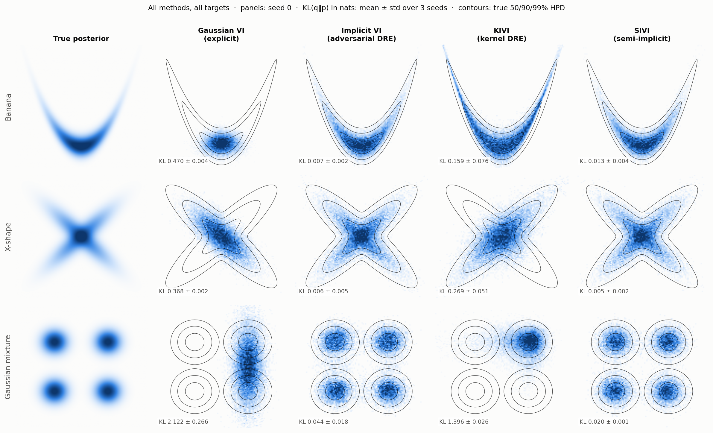

# Implicit Variational Inference with Adversarial Density-Ratio Estimation

*iCog Labs — Saturday AI training · Implicit Variational Inference*

Variational inference fits $q(z) \approx p(z\mid x)$ by minimising
$\mathrm{KL}(q\,\|\,p) = \mathbb{E}_q[\log q(z) - \log \tilde p(z)] + \log Z$.
An **implicit** $q$, a neural sampler $z = G_\phi(\varepsilon)$, can take almost any shape,
but $\log q(z)$ cannot be evaluated. This repo implements and compares four answers to
*"what do we do about $\mathbb{E}_q[\log q]$?"* on three hard 2D posteriors whose exact
ground truth we can compute.

| Method | How $\log q$ is handled | File |
|---|---|---|
| **Gaussian VI** (baseline) | closed form, but only an ellipse | [`gaussian_vi.py`](ivi/methods/gaussian_vi.py) |
| **Implicit VI + adversarial DRE** (main) | classifier logit $T(z)\approx\log q(z)-\log r(z)$ | [`adversarial.py`](ivi/methods/adversarial.py) |
| **KIVI** (bonus) | closed-form kernel least-squares estimate of $q/r$ | [`kivi.py`](ivi/methods/kivi.py) |
| **SIVI** (bonus) | lower bound $\mathcal{L}_K$ via a $K$-sample mixture, no ratio | [`sivi.py`](ivi/methods/sivi.py) |

**→ One-page summary of findings:** [`docs/summary.pdf`](docs/summary.pdf) ([markdown](docs/summary.md)) ·
**walkthrough notebook:** [`notebooks/walkthrough.ipynb`](notebooks/walkthrough.ipynb)



## Results

True reverse KL(q‖p) in nats (binning-free kNN estimate against the exact posterior), mean ± sd over 3 seeds.
Full table with forward KL, TV and timings: [`results/comparison_table.md`](results/comparison_table.md).

| | Gaussian VI | Adversarial DRE | KIVI | SIVI |
|---|---|---|---|---|
| Banana | 0.470 ± 0.004 | **0.007 ± 0.002** | 0.159 ± 0.076 | 0.013 ± 0.004 |
| X-shape | 0.368 ± 0.002 | 0.006 ± 0.005 | 0.269 ± 0.051 | **0.005 ± 0.002** |
| Gaussian mixture | 2.122 ± 0.266 | 0.044 ± 0.018 | 1.396 ± 0.026 | **0.020 ± 0.001** |
| Mixture modes covered | broad blob / 2 of 4 | 4/4 every seed | 1–2 of 4 | 4/4 every seed |

## The main method in four lines

1. Pick a reference $r(z)$ with a known density. Then
   $\mathbb{E}_q[\log q-\log\tilde p]=\mathbb{E}_q[\log\tfrac{q}{r}]+\mathbb{E}_q[\log r-\log\tilde p]$.
   Only the **ratio** is unknown.
2. A classifier trained with the logistic loss on $q$- vs $r$-samples has optimal logit
   $T^*(z)=\log q(z)-\log r(z)$.
3. The generator minimises $\mathbb{E}_\varepsilon[T(G(\varepsilon))+\log r-\log\tilde p]$ with $T$
   **frozen**. That is exact at $T=T^*$, because the $\phi$-dependence of $T^*$ contributes
   $\mathbb{E}_q[\nabla_\phi\log q_\phi]=0$.
4. So training **alternates**: $k$ classifier steps, then one generator step.

## Key findings (figures in [`figures/`](figures))

| Figure | Shows |
|---|---|
| [03](figures/03_density_ratio_check.png) | The learned logit matches an independent estimate of $\log q-\log r$ (corr. 0.94–0.96). |
| [04](figures/04_training_dynamics.png) | Classifier accuracy settles at the Bayes-optimal $\tfrac12(1+\mathrm{TV}(p,r))$, not 50 %; the method's own KL estimate is biased and noisy. |
| [05](figures/05_mode_discovery.png) | Reverse KL is mode-seeking: modes are discovered one split at a time (KL steps log 4 → log 2 → 0). |
| [06](figures/06_ablations.png) | More inner classifier steps mean a less biased gradient; a moving (adaptive) reference leaks mass into the tails in 2D. |
| [07](figures/07_sivi_bound.png) | SIVI: $\mathcal{L}_K\le$ ELBO, increasing in $K$; small $K$ collapses onto one mode. |
| [08](figures/08_kivi_sensitivity.png) | KIVI: bandwidth/ridge sensitivity and the median-heuristic feedback loop. |
| [gifs](figures/gifs) | All four methods learning each target. |

One finding applies to both ratio methods. The "tractable" term $\mathbb{E}_q[\log r-\log\tilde p]$ is
**unbounded below** wherever $r$ has lighter tails than the posterior (here, the banana's arms).
There, only the ratio estimate keeps $q$ from escaping. Neural classifiers extrapolate imperfectly;
kernel estimators cannot extrapolate at all, which is why KIVI uses a heavy-tailed Student-t
reference ([`reference.py`](ivi/methods/reference.py)).

## Repository layout

```
ivi/                    the package
  targets.py            banana, X-shape, mixture + exact grid ground truth and log Z
  metrics.py            kNN reverse KL, grid KL/TV, MMD, mode coverage
  methods/              gaussian_vi, adversarial, kivi, sivi, reference distributions
  diagnostics.py        learned-ratio check, Bayes-optimal classifier accuracy
  experiment.py         training loop, evaluation, caching, checkpoint/resume
configs/default.yaml    every hyperparameter (override with --set method.key=value)
scripts/                run_all.py + one plotting script per figure group
results/                metrics/histories per run (json) and summary tables
figures/                all figures and training GIFs
notebooks/              executed walkthrough
docs/                   one-page summary (pdf + markdown)
tests/                  ground-truth sanity checks
```

## Reproduce

```bash
python3 -m venv .venv && source .venv/bin/activate
pip install -r requirements.txt
python tests/test_targets.py                     # ground truth matches closed forms

python scripts/run_all.py                         # 4 methods x 3 targets x 3 seeds (~25 min on a laptop CPU)
python scripts/plot_baseline.py && python scripts/plot_main.py && python scripts/plot_comparison.py
python scripts/make_gifs.py
```

The ablation and bonus sweeps are listed at the top of [`plot_ablations.py`](scripts/plot_ablations.py)
and [`plot_bonus.py`](scripts/plot_bonus.py). Runs are cached (finished runs are skipped), and
`--time-budget SECONDS` pauses a sweep with a checkpoint; re-running the same command resumes it.

## References

- Blei, Kucukelbir & McAuliffe (2017). *Variational Inference: A Review for Statisticians.* arXiv:1601.00670
- Mescheder, Nowozin & Geiger (2017). *Adversarial Variational Bayes.* ICML
- Huszár (2017). *Variational Inference using Implicit Distributions.* arXiv:1702.08235
- Tiao. *Density Ratio Estimation for KL Divergence Minimization between Implicit Distributions* (blog post)
- Shi, Sun & Zhu (2018). *Kernel Implicit Variational Inference.* ICLR, arXiv:1705.10119
- Yin & Zhou (2018). *Semi-Implicit Variational Inference.* ICML, arXiv:1805.11183
- Foong. *Implicit inference reading-group notes*
